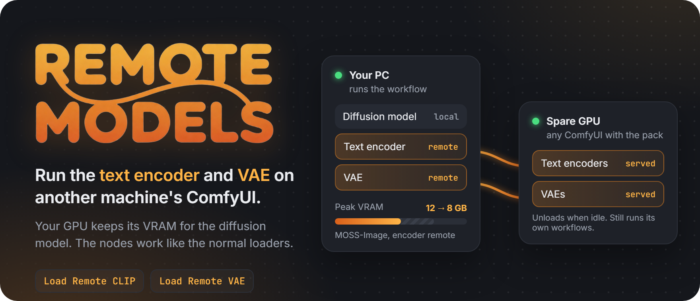
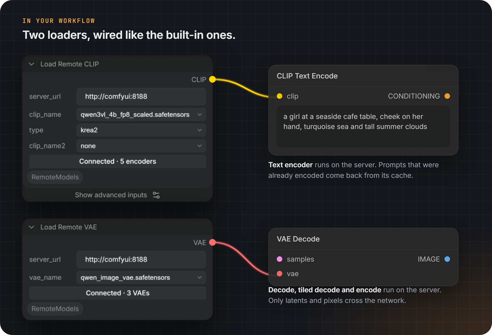
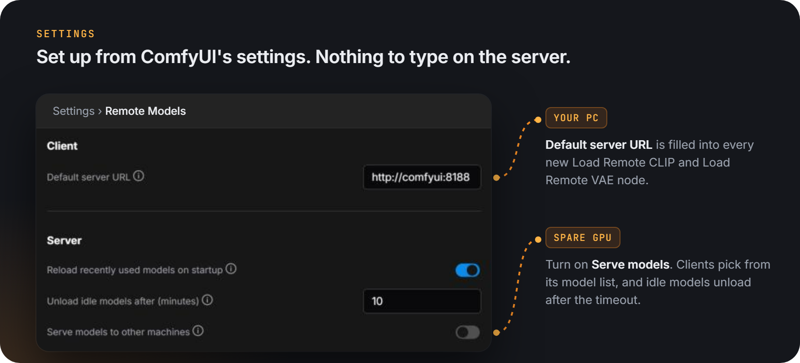

<p align="center"></p>

# ComfyUI Remote Models

**Why:** save VRAM. Text encoders take gigabytes and VAE decodes spike; put them on a spare GPU and keep yours for the diffusion model.

**How:** add **Load Remote CLIP** or **Load Remote VAE**, point it at the other ComfyUI, and use it like the normal loader.

<p align="center"></p>
<p align="center"></p>

## Install

Clone into `ComfyUI/custom_nodes` on both machines and restart ComfyUI:

```
git clone https://github.com/Mr-Quin/ComfyUI-RemoteModels
```

## Server

- Start ComfyUI with `--listen` and allow its port (8188) through the firewall.
- Put the model files in its `models/text_encoders` and `models/vae`. The client doesn't need them.
- In Settings > Remote Models, turn on **Serve models to other machines**.
- For VAE encodes of long videos, raise ComfyUI's request limit with `--max-upload-size` (in MB, default 100).

| Setting | Default | |
| --- | --- | --- |
| Serve models to other machines | off | Off answers every request with 403. |
| Unload idle models after (minutes) | 10 | `0` keeps them loaded. |
| Reload recently used models on startup | on | Avoids a slow first request after a restart. |

There is no authentication, same as ComfyUI itself, and the serve switch is not access control: anyone who can reach the port can change settings. Limit access to the port at the network level.

## Client

1. Optionally set **Default server URL** in Settings > Remote Models.
2. Add **Load Remote CLIP** or **Load Remote VAE** (loaders/remote) and enter the server URL, e.g. `http://192.168.1.50:8188`. It connects on its own and fills the file list.
3. Wire `CLIP` into your encode nodes and `VAE` into VAE Decode or Encode, tiled or not.

On the server machine itself, set the URL to `local` to share the already-loaded models with local workflows.

Reference workflows are in `example_workflows/`. Dragging `docs/icon.png` into ComfyUI loads the workflow it was made with (the background removal needs BiRefNet).

| Button shows | Fix |
| --- | --- |
| `Unreachable` | Check the URL, `--listen` and the firewall on the server. |
| `Server not serving` | Turn on serving in the server's settings. |
| `Pack missing or old on server` | Install or update the pack on the server and restart it. |
| `Version mismatch, update both` | Update the pack on both machines. |
| `Not on server: <file>` | Add that file to the server, or pick another. |

## Limitations

- Load Remote CLIP works with encode nodes that just tokenize and encode a prompt (CLIP Text Encode, Qwen image, MOSS-Image, Krea 2, Anima). SDXL, SD3 and Flux dual-prompt nodes, CLIP LoRAs and hooks are not supported.
- Load Remote VAE covers decode and encode, tiled or not. Nodes that reach into the VAE weights directly do not work with it.
- A remote VAE is only as fast as the server's GPU, and decoded images cross the network, so it trades speed for VRAM. Output can differ slightly from a local decode when the server has a different GPU.
- Remote requests wait while the server runs its own prompts, but a prompt queued on the server while a request is already running is not held back, and the two can disturb each other's models. Avoid generating on the server while clients use it.
- Embeddings in prompts come from the server's embeddings folder.
- After replacing a model file on the server, restart its ComfyUI.
- Settings are read from the default user, so servers started with `--multi-user` need serving turned on as that user.

## License

MIT
